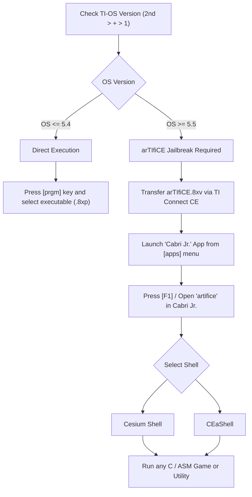

# TI-84 Plus CE Software & Game Archive

A curated, comprehensive archive of system shells, performance tweaks, productivity tools, math utilities, and games for the Texas Instruments **TI-84 Plus CE** and **TI-83 Premium CE** graphing calculators.

---

## Table of Contents

- [Overview & Compatibility](#overview--compatibility)
- [OS 5.5+ Jailbreak Workflow (arTIfiCE)](#os-55-jailbreak-workflow-artifice)
- [Archive Catalog](#archive-catalog)
    - [Shells & Program Launchers](#1-shells--program-launchers)
    - [System Utilities & Performance Tweaks](#2-system-utilities--performance-tweaks)
    - [Text Editors & Productivity Tools](#3-text-editors--productivity-tools)
    - [Simulations & Visualizations](#4-simulations--visualizations)
    - [Curated Games Collection](#5-curated-games-collection)
- [Installation & Usage Guide](#installation--usage-guide)
- [File Formats & Structure](#file-formats--structure)
- [Credits & Attribution](#credits--attribution)

---

## Overview & Compatibility

| Platform | Supported Models | Tested OS Range | Recommended Shell |
|---|---|---|---|
| **TI-eZ80 Hardware** | TI-84 Plus CE, TI-84 Plus CE-T, TI-84 Plus CE Python, TI-83 Premium CE | OS 5.0.0 through 5.8+ | Cesium or CEaShell via arTIfiCE |

> [!IMPORTANT]
> **OS 5.5+ Notice:** Starting with TI-OS version 5.5.1, Texas Instruments removed direct execution of native Assembly (eZ80 ASM) and C programs from the standard `[prgm]` menu. To execute ASM/C software on OS 5.5 or later, you must run the **arTIfiCE** jailbreak via Cabri Jr., which launches a shell such as **Cesium** or **CEaShell**.

---

## OS 5.5+ Jailbreak Workflow (arTIfiCE)

The following diagram illustrates how programs are loaded and executed based on the calculator's operating system version:



---

## Archive Catalog

### 1. Shells & Program Launchers

Shells bypass OS limitations, prevent accidental RAM clears, provide fast program searching, and enable launching programs directly from archive memory.

| Program / Directory | Primary Files | Language / Type | Description |
|---|---|---|---|
| **arTIfiCE** | `arTIfiCE.8xv` | AppVar / Exploit | Universal jailbreak for TI-OS 5.5+ utilizing Cabri Jr. to execute arbitrary ASM/C code. |
| **Cesium** (`cesium/`) | `cesium.8xp`, `cesium_french.8xp`, `cesium_dutch.8xp` | eZ80 C / ASM | Industry-standard program shell by MateoConLechuga. Features alpha search, RAM backup/restore, inverted dark mode shortcuts, file properties editor, and USB flash drive support. |
| **CEaShell** (`ceashell-release-v1.1.5/`) | `APPINST.8xp`, `AppInstA.8xv`, `AppInstB.8xv` | C Application | Modern shell by RoccoLox Programs featuring custom UI themes, program descriptions/icons, TI-BASIC program creation/editing, and file management. |

---

### 2. System Utilities & Performance Tweaks

| Utility / Directory | Key Files | Purpose & Capabilities |
|---|---|---|
| **Always-on Dark Mode** (`alwaysdark/`) | `DARKINST.8xp`, `DarkHook.8xv` | System hook that maintains inverted dark mode across power cycles (turning off and back on). |
| **Wait-State Booster** (`faster_2/`) | `faster.8xp`, `fastest.8xp`, `faster.asm` | Patches hardware wait states on flash execution from 9 wait-states down to 7 (`faster`) or 6 (`fastest`), delivering an immediate 2x–3x execution boost for OS and archived routines. |
| **Battery Estimation** (`battery_estimation/`) | `BATTERY.8xp` | Hardware query tool utilizing CCALLs to accurately estimate remaining battery capacity in 5 discrete tiers (<5%, 5–25%, 25–50%, 50–75%, >75%). |
| **C Standard Libraries** | `clibs.8xg`, standalone `.8xv` in `Derivative/` | Standard C runtime libraries (including `GRAPHX`, `FILEIOC`, `KEYPADC`, `FONTLIBC`, `LIBLOAD`). Required by nearly all C games and utilities on the CE. |

---

### 3. Text Editors & Productivity Tools

| Tool / Directory | File Assets | Description |
|---|---|---|
| **CEdit** (`cedit/`) | `cedit/src/*`, `DrMono.8xv`, `DrMono.bin`, `Makefile` | Full-featured text and code editor written in C. Supports editing appvars up to 16 KB (expandable to 64 KB), modifier holding, clipboard (cut/copy/paste), custom font loading (`DrMono`), and dialog integration with shells. |
| **CE Text Editor** (`CE Text Editor/`) | `NOTES.8xp`, `TFILES.8xp`, `ConvText.exe` | Text viewer and editor suite by M. Waltz. Includes a Windows utility (`ConvText.exe`) to convert standard `.txt` files to and from calculator AppVars. |
| **Derivative** (`Derivative/`) | `DERIV.8xp`, bundled library AppVars | Fast symbolic/numerical derivative utility with bundled C runtime dependencies. |
| **MATHTOOL** | `MATHTOOL.8xp` | All-in-one TI-BASIC mathematics suite covering algebra, polynomial operations, factoring, and equation solving. |

---

### 4. Simulations & Visualizations

| Tool / Directory | Primary Files | Description |
|---|---|---|
| **Conway's Game of Life** (`gamelife/`) | `GAMEL1FE_1x.8xp`, `GAMELIFE_2x.8xp`, assembly sources | Highly optimized 256-byte assembly port of Conway's Game of Life by Zemmargorp. Supports 1x1 and 2x2 cell modes with random initial board generation and full-screen rendering. |

---

### 5. Curated Games Collection

The `GAMES/` directory contains 28 popular games ported or originally developed for the TI-84 Plus CE color screen:

| Game | Main Executable | Required AppVars / Bundled Files | Category / Description |
|---|---|---|---|
| **2048** | `CE2048.8xp` | `clibs.8xg` | Puzzle: Sliding tile numerical puzzle. |
| **Adventur** | `ADVENTUR.8xp` | None | RPG / Adventure: Retro text & graphical exploration. |
| **Androides** | `ANDROIDES.8xp` | `ANDRODAT.8xv` | Action / Arcade: Lode Runner style platform puzzle game. |
| **Boxman** | `BOXMAN.8xp` | `graphc.8xv`, `clibs.8xg` | Puzzle: Sokoban crate-pushing puzzle game. |
| **Calcuzap** | `calcuzap.8xp` | None | Arcade: Fast-paced space shooter. |
| **Catylizm** | `CATYLIZM.8xp` | `clibs.8xg` | Strategy / Action: Turn-based tactical survival. |
| **Checkers** | `CheckersCE.8xp` | `clibs.8xg` | Board Game: Classic draughts with AI opponent. |
| **Chess** | `CHESS.8xp` | `clibs.8xg` | Board Game: Full chess engine with move validation. |
| **CMonster** | `cmonster.8xp` | None | Arcade: Breakout / Arkanoid brick-breaking clone. |
| **Dino Run** | `DINO.8xp` | `clibs.8xg` | Endless Runner: Offline Chrome dinosaur game clone. |
| **Donkey Kong** | `DKONG.8xp` | `clibs.8xg` | Classic Arcade: Faithful port of the arcade platformer. |
| **FALLDOWN** | `FALLDOWN.8xp` | `clibs.8xg` | Arcade: High-speed falling ball survival game. |
| **Flappy Bird** | `FLAPPYB.8xp` | `clibs.8xg` | Arcade: Tap-to-jump obstacle avoidance clone. |
| **Geometry Dash** | `AGD.8XP` | `STEREO_MADNESS.8xv`, `DRY_OUT.8xv`, `GDGrphc.8xv`, `GDMenu.8xv` | Rhythm Platformer: Music-synchronized obstacle jumping with multiple levels and graphics packs. |
| **Minesweeper** | `MINES.8xp` | `graphc.8xv`, `clibs.8xg` | Logic Puzzle: Classic Windows-style minesweeper. |
| **Oiram (Super Mario)** | `OIRAM.8xp` | `OiramPK.8xv`, `OiramS.8xv`, `OiramT.8xv`, `clibs.8xg` | Platformer: Comprehensive Mario clone with scrolling levels, physics, and enemy AI. |
| **Oregon Trail** | `OREGON.8xp` | `clibs.8xg` | Simulation: Historical frontier travel simulation. |
| **Pac-Man** | `PacMan.8xp` | None | Classic Arcade: Maze navigation and ghost chasing. |
| **Portal** | `Portal.8xp` | `Portal1P.8xv` | Puzzle Platformer: 2D portal mechanics and physics puzzles. |
| **Puzzle Frenzy** | `FRENZY.8xp` | None | Puzzle: Panel de Pon / Puzzle League action puzzler. |
| **Snailmaze** | `snailmze.8xp` | None | Maze: Retro maze navigation game. |
| **Snake CE** | `SNAKECE.8xp` | `clibs.8xg` | Classic: High-refresh color snake game. |
| **Snowball Struggle** | `SNOW.8xp` | `clibs.8xg` | Action: Winter snowball battle action game. |
| **Spaze Invaders** | `spaze.8xp` | None | Arcade: Space Invaders fixed shooter. |
| **Stacker** | `STACKER.8xp` | `clibs.8xg` | Arcade: Block alignment arcade timing challenge. |
| **SwipeCE** | `SWIPE.8xp` | `graphc.8xv`, `clibs.8xg` | Casual / Puzzle: Swipe-based tile puzzle. |
| **Tetris (Tetrica)** | `tetrica.8xp` | None | Puzzle: Fast, responsive falling tetrominoes game. |
| **This is the Only Level** | `TITOL.8xp` | `clibs.8xg` | Metagame Platformer: Single stage with mutating mechanics. |
| **Zombie Chase** | `ZMBCHS.8xp` | `clibs.8xg` | Survival: Grid-based evasion and zombie defense. |

---

## Installation & Usage Guide

### Transfer Software via Computer

1. **Connect Calculator**: Plug your TI-84 Plus CE into your computer via a standard USB-A/C to Mini-B cable.
2. **Software Options**:
    - [TI Connect™ CE](https://education.ti.com/en/products/computer-software/ti-connect-ce-sw) (Official, Windows / macOS)
    - [TiLP](http://lpg.ticalc.org/prj_tilp/) (Cross-platform, open source, Linux / Windows / macOS)
3. **Send Core Libraries**:
    - Send `clibs.8xg` to the calculator. When prompted, select **Archive** as destination to preserve RAM.
4. **Send Files**:
    - Drag and drop `.8xp` (Programs), `.8xv` (AppVars), and `.8xg` (Group files) into the transfer window.
    - **Always send associated AppVars:** If a game lists AppVars in the catalog above (e.g. `OIRAM` requiring `OiramPK.8xv`, `OiramS.8xv`, and `OiramT.8xv`), all AppVars must be present on the calculator for the program to launch.

### RAM vs. Archive Recommendations

| Memory Area | Capacity | Purpose | Recommendation |
|---|---|---|---|
| **RAM** | ~154 KB | Working memory for execution | Keep clear of large games. Executing programs unarchives them to RAM automatically. |
| **Flash Archive** | ~3.0 MB | Permanent storage across resets | Store all programs, games, AppVars, and `clibs` in Archive. |

> [!TIP]
> If your calculator experiences a RAM clear (e.g., due to a crash or battery depletion), all archived programs and libraries remain intact in flash storage.

---

## File Formats & Structure

```text
ti-84-plus-ce-archive/
├── GAMES/                          # Curated collection of classic and community CE games
├── ceashell-*/                     # CEaShell GUI desktop environment and launcher
├── cedit/                          # CEdit text and source code editor
├── cesium/                         # High-performance graphical program launcher
├── arTIfiCE.8xv                    # Jailbreak payload AppVar for OS 5.5+
└── clibs.8xg                       # C standard runtime libraries bundle
```

### File Extension Reference

- **`.8xp`**: TI-84 Plus CE Program (TI-BASIC script or compiled eZ80 binary).
- **`.8xv`**: Application Variable (AppVar) storing binary graphics, levels, sound/music data, or system hooks.
- **`.8xg`**: Grouped archive file containing multiple `.8xp` or `.8xv` resources.
- **`.asm` / `.c` / `.h`**: Uncompiled source code for developers.

---

## Credits & Attribution

Gratitude is extended to the vibrant TI community developers whose work makes this archive possible:

- **MateoConLechuga (Matt Waltz)** — Cesium shell, C toolchain, `ConvText`, and wait-state routines.
- **RoccoLox Programs** — CEaShell, Always Dark, and numerous eZ80 utilities.
- **The-ノン-Pro / Yvan Maillard** — arTIfiCE jailbreak exploit.
- **CE-Programming Team** — CE C toolchain, standard libraries (`clibs`), and emulator support.
- **Zemmargorp** — GAMELIFE assembly engine.
- **Privacy_Dragon** — Battery estimation tool and Cesium localization.
- **Community Authors & Porters** — The creators of all game ports and homebrew titles in the `GAMES/` catalog.
